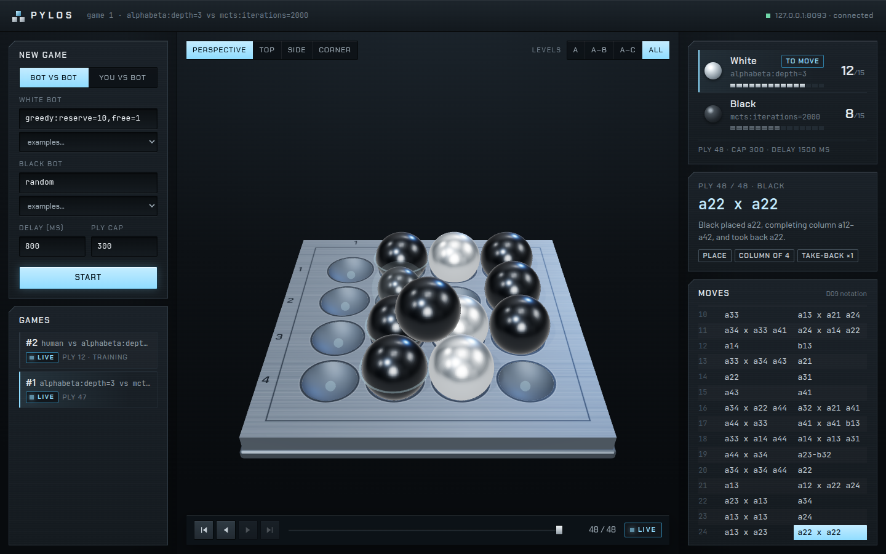
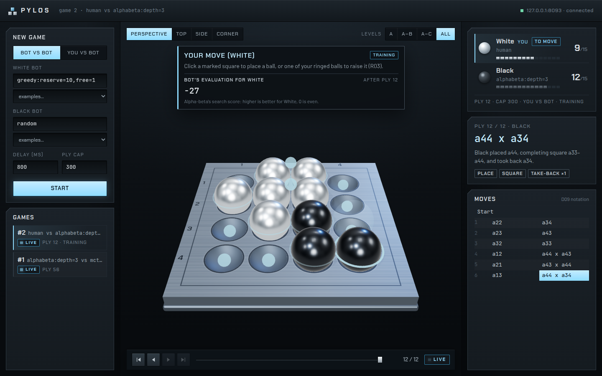
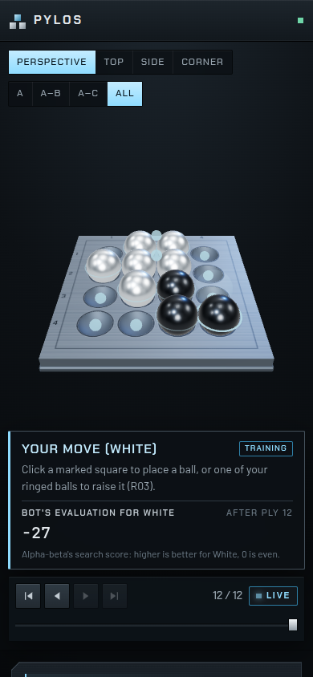
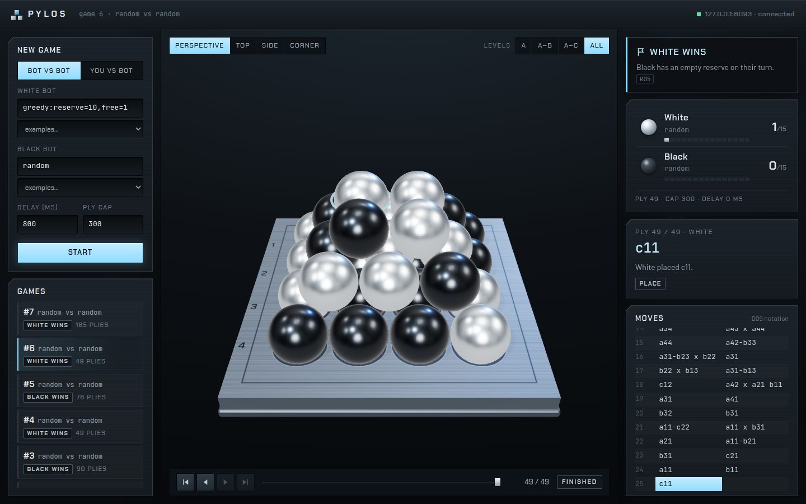

# Pylos

**Play the board game Pylos against a computer opponent, or watch two bots
play each other, on a 3D board in your browser.**



Pylos is a two-player strategy game. Players take turns stacking balls into a
pyramid. Whoever runs out of balls first loses, so the game is about making
every ball count. This project is the game written in Haskell: a rules
engine, several bots of different strength, and a web page with a 3D board
that you can rotate and zoom.

## Features

- **You vs bot.** Pick your colour and an opponent, then play by clicking or
  tapping the board. Only legal moves can be made, and the board shows where
  you can play.
- **Training games.** After every move, the bot shows how it rates the
  position, so you can see which moves it thinks were good or bad.
- **Bot vs bot.** Choose two bots, set the speed and watch. Step back through
  any game move by move.
- **Phone and big screen.** The page works with a mouse or with touch. On your
  home network, a phone can open it too.

| Training game against alpha-beta | On a phone | Game over |
|---|---|---|
|  |  |  |

## The rules in short

- Each player has **15 balls**. The pyramid has **4 levels**: 4×4, 3×3, 2×2
  and the single apex.
- On your turn, **place** a ball from your reserve on any empty square. A
  square on an upper level can be used only when the 4 balls beneath it are
  there.
- Or **raise** one of your own balls that has nothing on top of it to a higher
  level. That saves a ball from your reserve.
- When your move completes a **2×2 square** of your colour, or a **full row of
  4** on the bottom level, you may **take back 1 or 2** of your free balls.
- **If it is your turn and you have no balls left, you lose.**

The full rules, with examples and the move notation used in the move list:
**[docs/rules.md](docs/rules.md)**.

## The bots

Each bot is written as a short spec with at most one setting. Type it into the
form, or pick one from the examples list.

| Spec | What it does |
|---|---|
| `random` | a random legal move |
| `greedy:reserve=10,free=1` | the best move one ply ahead; the weights for reserve and free-ball advantage |
| `alphabeta:depth=3` | alpha-beta search, depth 1–8 (depth 3 ≈ 0.1 s per game, depth 4 a few seconds) |
| `mcts:iterations=2000` | Monte Carlo tree search, 1–200000 iterations per move |

A higher depth or more iterations usually plays better, but the bot thinks
longer before each move.

## Install

Pylos is built from source. These steps are for Ubuntu.

1. System libraries:

   ```sh
   sudo apt install build-essential curl libffi-dev libgmp-dev libncurses-dev
   ```

2. The Haskell toolchain through ghcup:

   ```sh
   curl --proto '=https' --tlsv1.2 -sSf https://get-ghcup.haskell.org | sh
   source ~/.ghcup/env
   ghcup install ghc 9.10.1
   ghcup install cabal recommended
   cabal update
   ```

3. Build (the first build takes a few minutes):

   ```sh
   cabal build all
   ```

If the build stops with `cannot find -lgmp`, see
[No libgmp-dev](docs/technical.md#no-libgmp-dev).

## Play

Start the server from the project folder:

```sh
$(cabal list-bin pylos-web) 8080 web
```

Open **http://localhost:8080** in a browser.

- **To play:** choose **You vs bot**, your colour, a bot, and **Real** or
  **Training**, then press **Play**. Click a marked square to place a ball.
  To raise, click one of your ringed balls, then the square to move it to.
  When you complete a shape, click the balls you want back, then confirm.
- **To watch:** choose **Bot vs bot**, type or pick a bot for each side, set
  the delay between moves, and press **Start**.
- **The board:** drag to rotate, scroll or pinch to zoom, right-drag to pan.
  The buttons above the board switch views and show only some levels.

### On a server without a screen

Open an SSH tunnel from your laptop, then browse to http://localhost:8080 on
the laptop:

```sh
ssh -N -L 8080:localhost:8080 <server>
```

### From a phone on your home network

By default only the computer running the server can open the game. To allow a
phone or another computer on the same network, add `--lan`:

```sh
$(cabal list-bin pylos-web) --lan 8080 web
```

The server prints the address to open on the phone. **Anyone on the same
network can then open the game; there is no password.** Use it only on a
network you trust, and never make the port reachable from the internet. If
the phone cannot connect, check the server's firewall (for example `ufw`).

## More

- [docs/rules.md](docs/rules.md): the full rules and the move notation
- [docs/technical.md](docs/technical.md): how it is built, command-line tools,
  tests, project layout
- [docs/adr/](docs/adr/): the decision records, one per design choice
